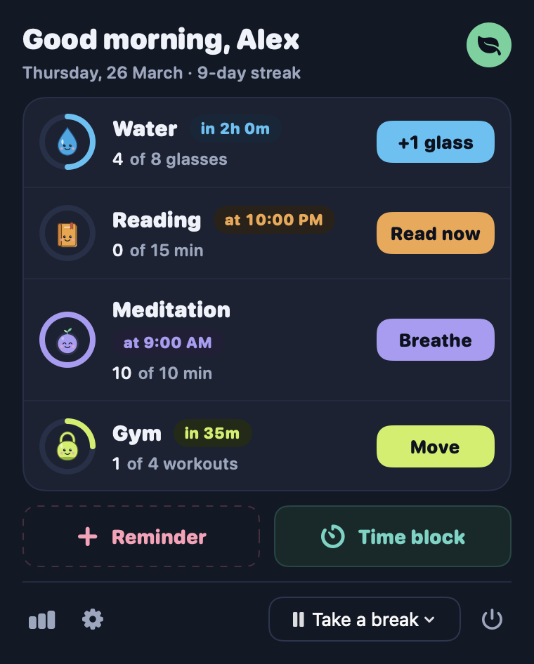
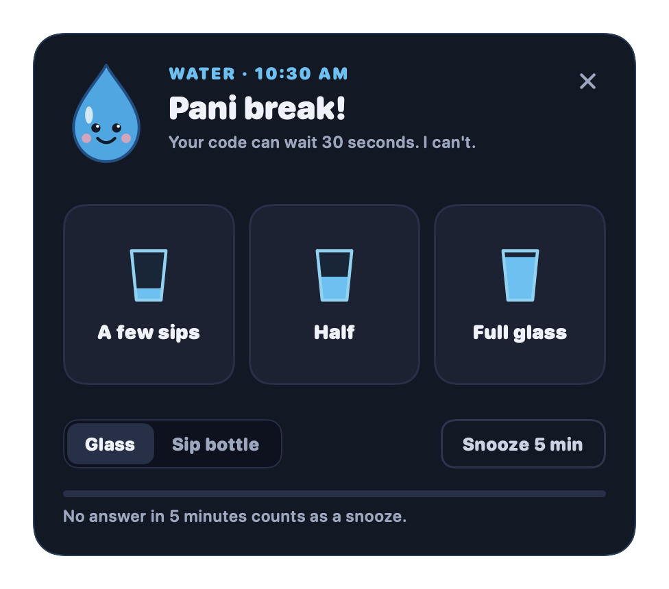
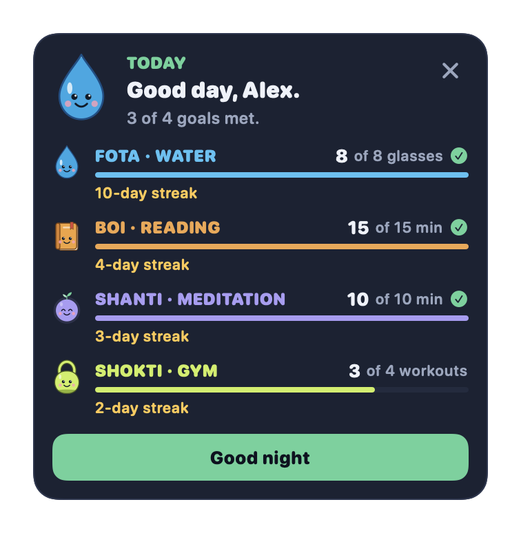
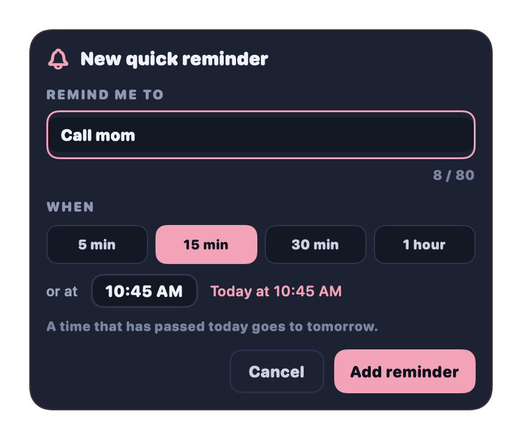
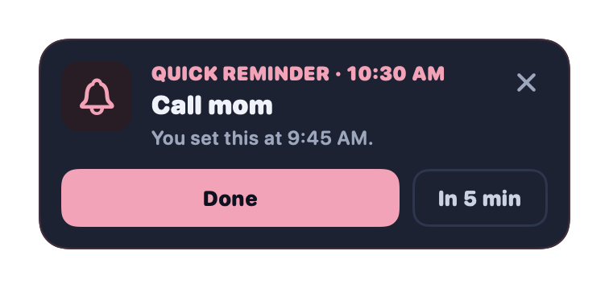
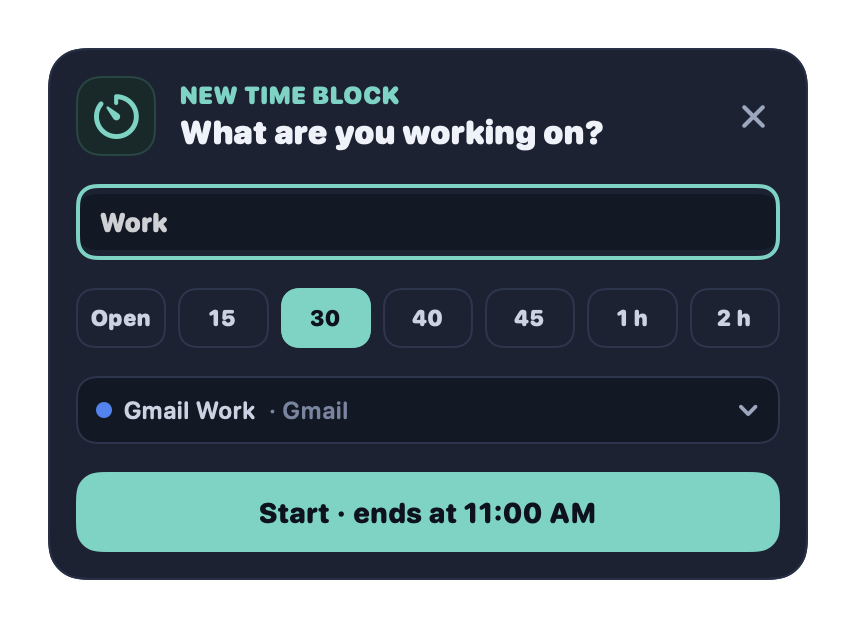
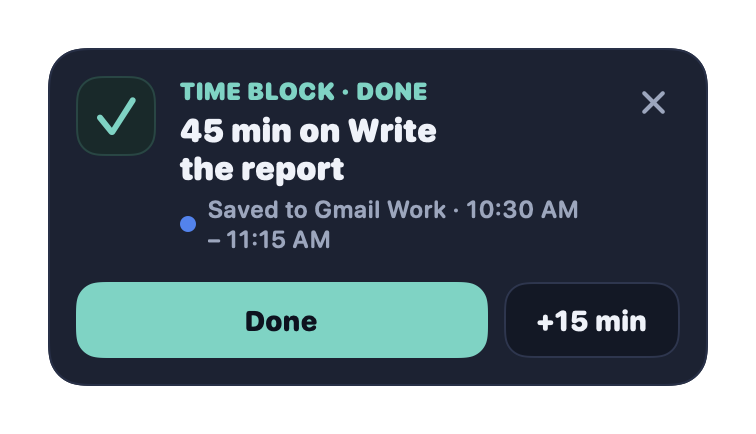
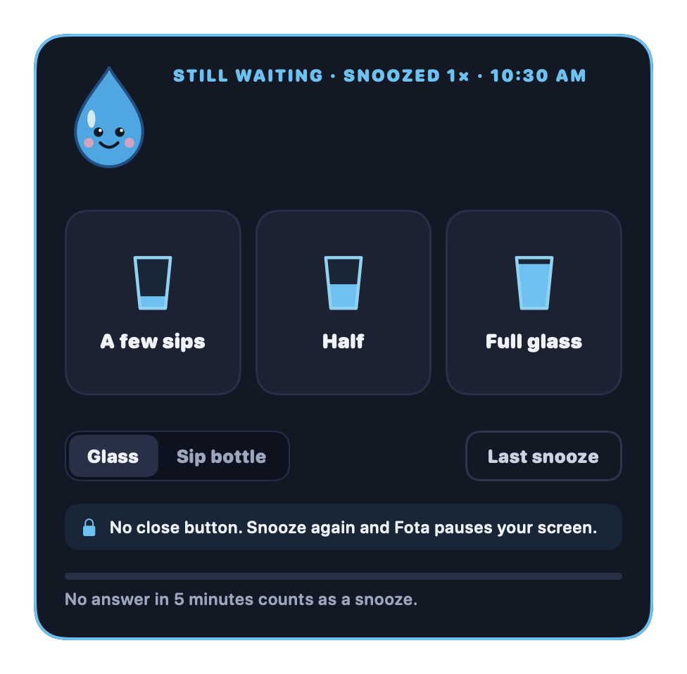
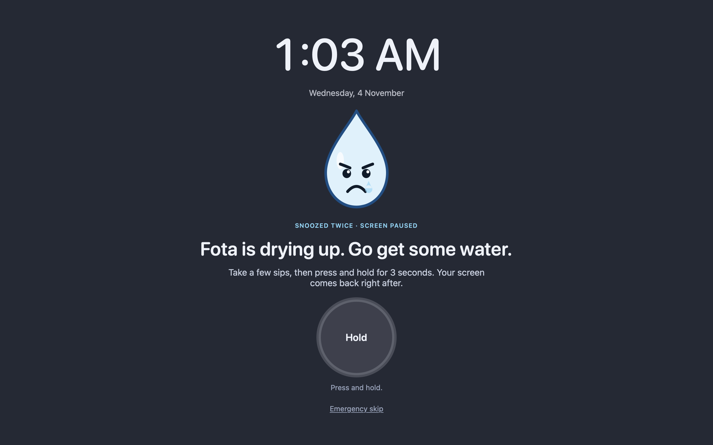
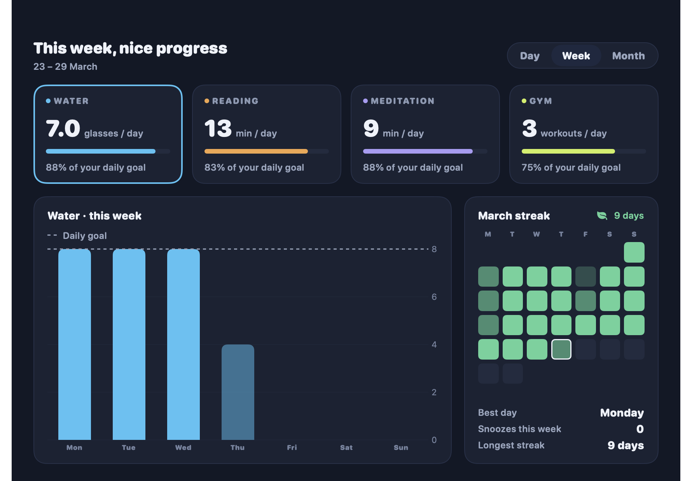

<p align="center">
  
</p>

<h1 align="center">Sathi</h1>

<p align="center">
  A free macOS menu bar app with four buddies that remind you to <b>drink water</b>, <b>read</b>, <b>meditate</b>, and <b>move</b>.
</p>

<p align="center">
  <a href="https://github.com/Sumonta056/sathi-app/releases/latest/download/Sathi.dmg"><b>Download for Mac</b></a> ·
  <a href="https://sumonta056.github.io/sathi-app/">Website</a> ·
  <a href="https://github.com/Sumonta056/sathi-app/blob/main/CHANGELOG.md">What is new</a>
</p>

<p align="center">
  <a href="https://github.com/Sumonta056/sathi-app/releases/latest"></a>
  <a href="https://github.com/Sumonta056/sathi-app/actions/workflows/ci.yml"></a>
  
  <a href="https://github.com/Sumonta056/sathi-app/blob/main/LICENSE"></a>
</p>

<p align="center">
  
</p>

## Install

Needs macOS 13 Ventura or newer, on Apple silicon or Intel.

1. Download [`Sathi.dmg`](https://github.com/Sumonta056/sathi-app/releases/latest/download/Sathi.dmg) and drag Sathi to **Applications**.
2. Open Sathi once. Sathi is not notarized by Apple, so macOS asks first. Go to **System Settings → Privacy & Security** and click **Open Anyway**. On macOS 13 and 14 you can also right-click Sathi and choose **Open**.
3. A drop appears in your menu bar. Click it, then the gear icon. On the General tab, turn on **Open Sathi when I log in**.

To see a reminder right away, open Settings, pick a buddy, and click **Show a reminder now**.

## The buddies

- **Fota** (water): a reminder every 2 hours between 9:30 and 18:30. Log a few sips, half, or a full glass, or drag the line on your sip bottle. The daily goal is 8 glasses.
- **Boi** (reading): a small popup in the top-right corner at 22:00. It never takes focus from your work. Start a 15-minute timer, and Boi counts the minutes. Pick the days of the week. Keep a reading list of links: "Start reading" opens today's pick.
- **Shanti** (meditation, off by default): short guided breathing sessions (Calm 4·6 by default, or box, relax, or even). You can pause a session. A voice guide and soft background music are optional. Pick a daily goal of 5, 10, or 20 minutes. Shanti reminds you every hour between 9:00 and 21:00 and stops for the day when you reach the goal.
- **Shokti** (gym, off by default): a small popup in the top-right corner every hour between 9:00 and 17:00 on the days you pick. It suggests 1 short workout from your list of 4 (a stretch, a short walk, squats, push-ups), in order. Start a short timer, and "Done" saves the workout. The daily goal is 4 workouts. The close button and "In 5 min" snooze it.

<p align="center">
  
  
  
</p>

## Day summary

Every evening at 22:00 a calm corner popup shows today's progress of the 4 buddies, with a streak for each. When every goal is met, it says congratulations. It shows once a day and stays until you close it. Change the time or turn it off in Settings, General tab.

<p align="center">
  
</p>

## Quick reminders

Write a one-off note such as "Call mom" and pick when it shows: 5 min, 15 min, 30 min, 1 hour, or a time of day. A calm corner popup shows it then and keeps coming back until you tap **Done**. Snooze it or close it. Up to 20 can be pending at once. A quick reminder is a note, not a habit, so it has no streak or goal. Its level is set in Settings, General tab. Tap **Reminder** in the menu to add one: a small popup opens, and you pick a time with a tap grid in 5-minute steps.

<p align="center">
  
  
</p>

## Time blocks

Track your work in the macOS Calendar app. Tap **Time block** in the menu, type a title, pick a length (15, 30, 40, 45, 60, or 120 min, or Open), and pick a calendar. When the block ends, Sathi saves 1 event to that calendar. A planned block asks "Done" or "+15 min". An open block checks in every 2 hours. The menu bar shows the minutes, and an optional pill in the corner shows a live timer. You can drag the pill. For 4 seconds after Start, the pill shows **Undo**. Settings has a Time blocks page for the default calendar, the display, and the sound. Sathi asks for calendar access the first time and never reads your events.

<p align="center">
  
  
</p>

## Reminders that escalate

If you ignore a reminder, it gets firmer, step by step:

| Level | What happens |
|---|---|
| Gentle | A reminder each time. It never stays on top. |
| Nudgy | After 1 snooze, the reminder stays on top and wiggles. |
| Strict | After 2 snoozes, a full-screen lock. Hold a button for 3 seconds to unlock. An emergency skip is always there. |

Each buddy has its own level: Gentle, Nudgy, or Strict. At Strict, any buddy locks the screen after 2 snoozes. Only one lock shows at a time. Each buddy also has a "Show a close button" switch. An optional snooze limit (1 to 15) in the General tab takes the snooze away at the limit: the reminder stays until you act, and a buddy offers "Skip today". Each buddy reminds you on its own, so two reminders can show at once: they stack in the top-right corner of the display with your mouse pointer. The **Take a break** menu in the popover pauses buddy reminders for 30 minutes, 1 hour, or the rest of the day. Quick reminders still show during a break.

<p align="center">
  
  
</p>

See [every reminder on the website](https://sumonta056.github.io/sathi-app/#gallery): the thank-you cards, the reading timer, the breathing session, and more.

## Reports and settings

- The Reports window shows each habit by day, week, or month, with a chart, a streak calendar, your best day, and your longest streak.
- Each buddy has its own Settings page. Water: interval, active hours, container, goal, strictness. Reading: time, weekdays, session length, style, reading list, strictness. Meditation: daily goal, session length, interval, active hours, breathing style, strictness, and a Sound card for the voice guide, music, bell, tick, and a preview. Gym: interval, work hours, work days, your 4 workouts (name and minutes), strictness. You pick times on a grid in 5-minute steps. Every buddy also has its own weekdays and a list of days off (pick them on a month calendar): on a day off that buddy stays quiet, and the day never breaks its streak.
- The General tab holds your name, snooze length, snooze limit, when no answer counts as a snooze, sound, the day summary, quick reminders, and open at login.
- The Time blocks page holds calendar access, the default calendar, menu bar or corner pill, and the sound.

<p align="center">
  
</p>

## Privacy

Sathi makes no network requests. All data stays on your Mac in `~/Library/Application Support/Sathi/`. Time blocks are the only exception: with your permission, Sathi writes each block as an event to the calendar you pick, through macOS Calendar, and that calendar's account can sync it.

| File | Holds |
|---|---|
| `prefs.json` | Settings |
| `state.json` | Live state (bottle level, last water time, streak resets) |
| `history/YYYY-MM.json` | Every done, snooze, and skip of one month, kept forever |

Sathi 1.0 kept data in UserDefaults (`com.mridul.sathi`). Sathi 2.0 moves it to these files once, on first launch, and keeps the old data as a backup for one release.

## Build from source

Needs Xcode 15 or newer. SwiftLint and SwiftFormat: `brew install swiftlint swiftformat`.

```sh
xcode-select --install
git clone https://github.com/Sumonta056/sathi-app.git
cd sathi-app
./build.sh --install
```

| Task | Command |
|---|---|
| Build | `swift build` |
| Run the app from source | `swift run` |
| All tests (unit + UI) | `./scripts/test.sh` |
| Lint and file-size check | `./scripts/lint.sh` (`--fix` to format) |
| Install the release app | `./build.sh --install` |
| CPU, memory, and wakeups budget | `./scripts/perf.sh` |
| Memory leak check over window open and close | `./scripts/perf.sh --windows` (run it in Terminal) |
| Make a DMG installer | `./scripts/make-dmg.sh` → `build/Sathi-<version>.dmg` and `build/Sathi.dmg` |
| Make the website screenshots | `SATHI_SHOTS="$PWD/site/screenshots" swift test --filter WebsiteShots` |
| Check the website files | `./scripts/check-site.sh` |

## Releases

A tag `vX.Y.Z` on `main` starts `.github/workflows/release.yml`. It checks that the tag matches `CFBundleShortVersionString` in `Resources/Info.plist` and that `CHANGELOG.md` has a section for the version. Then it runs the tests, builds the DMG, and attaches `Sathi-X.Y.Z.dmg` and `Sathi.dmg` to the GitHub Release.

The DMG is ad-hoc signed. To sign and notarize a local build with an Apple Developer ID:

```sh
xcrun notarytool store-credentials sathi-notary
SIGN_IDENTITY="Developer ID Application: Your Name (TEAMID)" NOTARY_PROFILE=sathi-notary ./scripts/make-dmg.sh
```

## Structure

- `Sources/SathiCore`: models, one module per habit (`Habits/<Name>/`), schedule, escalation, stats, reports, export, file storage, copy, and the `Engine` state machine. No AppKit or SwiftUI.
- `Sources/SathiUI`: the Night theme, shared components, SwiftUI views (one feature per folder), buddy drawings, and window management.
- `Sources/Sathi`: the app entry point and composition root.
- `Tests/`: Swift Testing unit tests, ViewInspector UI tests, and shared fakes.
- `site/`: the website, deployed to GitHub Pages by `.github/workflows/pages.yml`.
- `docs/`: the roadmap, the spec of each phase, and the design reference images.

`CLAUDE.md` has the full module map, rules, and definition of done. To add a habit, follow `.claude/skills/add-habit/SKILL.md`.

## Credits

- Fonts: Figtree, SIL Open Font License 1.1 (`Sources/SathiUI/Resources/Fonts/OFL.txt`).
- Music: "Babylon Meditation" by leberch (Pixabay Content License).

## License

[MIT](https://github.com/Sumonta056/sathi-app/blob/main/LICENSE) © Sumonta Saha Mridul
